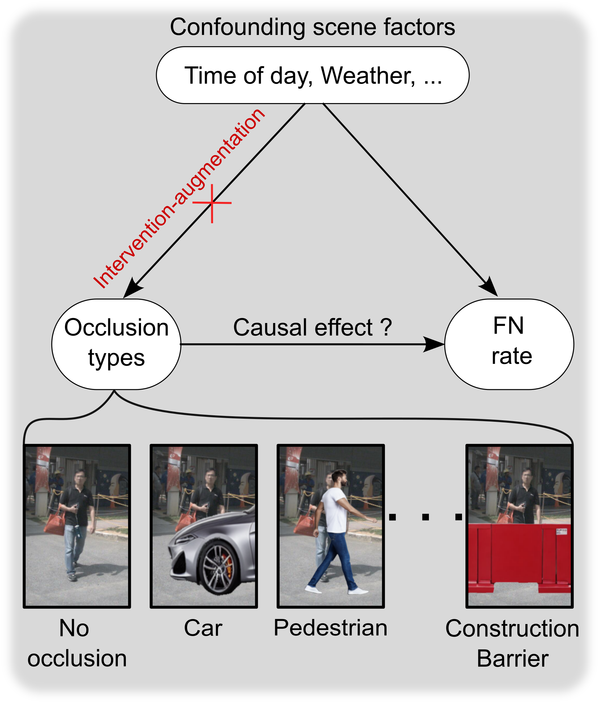

# causal-occlusion-validation


| Framework overview | <div align="center">Description</div> |
| :---: | :--- |
| <figure align="center"></figure> | Our intervention-augmentation framework outputs photorealistic </br> occlusions. These augmented images are thereafter used to analyse  </br> the causal effect of occlusion on the False Negative (FN) rate of </br> pedestrian detection models. This analysis can be formalized using  </br> the Average treatment effect (ATE)  <br><br> <div style="text-align: left;"><span style="white-space: nowrap;">$`\text{ATE} = \underbrace{P( FN\|\text{do}(Occlusion \approx 50\%))}_{\text{augmented images}}-\underbrace{P(FN\| \text{do}(Occlusion=None))}_{\text{original images of fully visible pedestrians}}`$</span></div><br><br> The full framework is described in our paper (under submission) [X] |


## Getting started

The repo contains three notebooks. 


1. **nuScenes-data-extractor.ipynb:** This script extracts the nuScenes metadata and exports it into a single CSV file.
2. **ML-prediction.ipynb:** Utilizing the metadata extracted in the previous step, this script predicts the False Negative (FN) rate under synthetic occlusions. The results are exported as a series of CSV files, with each file containing the FN predictions for a specific synthetic occlusion. 
3. **Analysis.ipynb:** This script uses the CSV outputs from step 2 to perform a causal analysis of synthetic occlusions across the Operational Design Domain (ODD). To conduct this analysis, we formulate four distinct interventions, as described in our paper [X]. These interventions can be modified directly within the code to accommodate alternative scenarios or custom formulations.         

These notebooks must be executed sequentially. The following sections provide further detailed instructions for configuring the environments and provide additional required steps to run these notebooks.

---

### 1. `nuScenes-data-extractor.ipynb`

This notebook extracts pedestrian metadata and bboxes from the nuScenes dataset. 

#### Step 1: Create and Activate the Conda Environment

The extraction script requires the official `nuscenes-devkit`. Create and activate the dedicated Conda environment using the provided YAML configuration file:

```bash
conda env create -f environment_nuScenes_data_extractor.yml
conda activate nuScenes
```

#### Step 2: Configure the Dataset Path

In the notebook's initial configuration cell, set the `file_path_nuscenes` variable to the local directory where the nuScenes dataset is stored:

```python
file_path_nuscenes = "/path/to/nuscenes/dataset"
```

#### Step 3: Execute the Notebook

Execute all notebook cells sequentially. The script outputs following file containing the pedestrian metadata in nuScenes:

```text
Pedestrians_annotations_filtered_FOV_with_rain_3D_bbox_eulerian_angles.csv
```

---


### 2. Generating realistic occluding objects
Prior to executing the *ML-prediction.ipynb* notebook, please checkout the PNG images of occluding objects in the \images\occluding-objects directory. Currently, these 12 occluding objects are used to run our causal evaluation. These synthetic objects were generated using the ControlNet model [1]. To utilize ControlNet for your own custom image generation, please refer to the documentation available at https://github.com/lllyasviel/controlnet

---

### 3. ML-prediction.ipynb
The code utilizes the *MMDetection3D* framework in order to test a wide range of 3D detection models. Use the following commands to set up the environment.

#### Step 1: Create and activate the Conda environment:

```bash
conda create env create -f environment_openmmlab3D.yml
conda activate openmmlab3D
```


#### Step 2: Install MMDetection3D:

Although the environment contains most required packages (e.g., pandas, numpy), you must also install MMDetection3D within the conda environment using pip commands. Please follow the official installation instructions (https://mmdetection3d.readthedocs.io/en/latest/get_started.html).


#### Step 3: Download bbox package into the the folder:

This notebook uses also the *bbox* package from https://github.com/varunagrawal/bbox to compute the FN of each prediction. Clone or place this package into the project working directory:

```bash
git clone https://github.com/varunagrawal/bbox.git
```

#### Step 4: Configure the Dataset Path

In the cell which pre-processes the nuscens info file, set the `file_path_nuscenes` variable to the path where nuscenes is stored:

```python
file_path_nuscenes = "/path/to/nuscenes/dataset"
```


#### Step 5:  Execute the Notebook

Run all cells sequentially to generate the predictions and export the resulting CSV files to the designated output directory. Store the CODIF augmentation CSV's in */results/CODIF*, the photo-realistic augmentations in */results/photo-realistic*, and the associational-based (no augmentations) in */results/associational-no-augmentation/*

---
### 4. Analysis.ipynb

#### Step 1: Manual Annotation Setup
Due to OSS license constraints, we cannot distribute our annotated nuScenes dataset directly within this repository. Consequently, these annotations must be reconstructed manually by the user. To do so, the user can draw a subsample (e.g., 5,000 samples) from the CSV file generated by nuScenes-Data-Extractor.ipynb. Once annotated, this file should be saved as Final_5k_annotated_occlusions.csv in root directoy. The get_prob function in the Analysis.ipynb notebook will automatically read this file to compute the conditional probabilities used in the intervention formulations.

#### Step 2: Execute the cells in  Analysis.ipynb sequentially
The Analysis.ipynb notebook executes the causal analysis of the synthetic occlusions. The specific formulation of these interventions (e.g., evaluating the conditional probability of occlusion types conditioned on the scenario, time of day, and weather conditions) is detailed in our paper [X]. This notebook can be run directly within the nuScenes environment configured in step 1.


---
## Running time

Hardware - NVIDIA A100 GPU (64 GB VRAM) with a multi-core CPU host environment.

1. **`nuScenes-data-extractor.ipynb` (~2 hours):** Metadata extraction and preprocessing.
2. **`ML-prediction.ipynb` (~48 hours total):**
   - **24 hours:** Synthetic occlusion augmentations evaluated across both models ($N = 10{,}000$ fully visible pedestrians).
   - **24 hours:** Associational evaluation without augmentations across both models for ~20,000 half-occluded pedestrians and ~60,000 fully visible pedestrians
3. **`Analysis.ipynb` (~24 hours):** Causal intervention analysis executed in parallel across 4 CPU cores.


---

## Citation

If you use this repository in your research, please cite:

```bibtex
Currently under submission
```
---

## References

[1] L. Zhang, A. Rao, and M. Agrawala, "Adding conditional control to text-to-image diffusion models," in *Proceedings of the IEEE/CVF International Conference on Computer Vision (ICCV)*, 2023, pp. 3813-3824.

[X] Our paper is currently under submission


